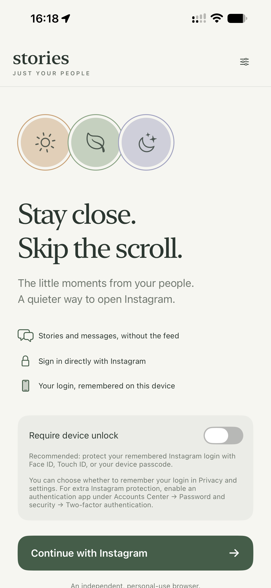
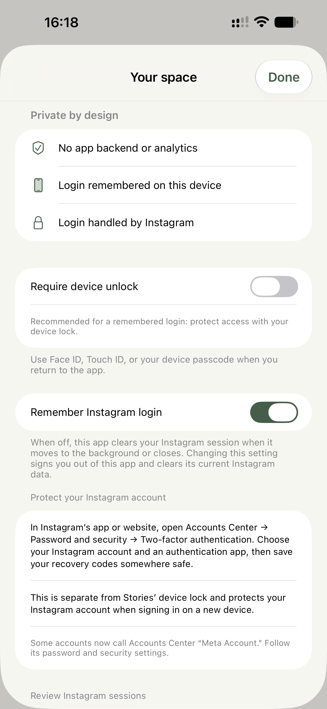

# Quiet Stories

An independent iPhone/iPad browser for Instagram Stories and messages, built with SwiftUI and WKWebView. The Xcode project and scheme are named `Stories`. There are no third-party packages, account service, backend, analytics, scraping, or private Instagram API calls.

## A look inside

<table>
  <tr>
    <th align="center">A quieter welcome</th>
    <th align="center">On-device preferences</th>
  </tr>
  <tr>
    <td align="center"></td>
    <td align="center"></td>
  </tr>
</table>

## Build and run

Development requires macOS, Xcode with an iOS 17 or newer SDK, and an installed iOS Simulator runtime for tests. Physical devices must run iOS 17 or newer. No package installation, Meta app registration, API key, or server is required.

Open `Stories.xcodeproj` in Xcode, or run:

```sh
sh scripts/open-main.sh
```

The script's historical name does not require `main`: ordinary clones, contributor branches, detached checkouts, and source archives are supported. The build logs its source location and available Git revision so you can identify the code being installed. Uncommitted changes are included in a local build; pushing to GitHub does not update an installed app. Build and run again to install changes.

The owner can opt in to requiring `main` in the primary checkout with `git config stories.requirePrimaryMain true`. This local preference is optional and is not a contributor requirement.

### Install on an iPhone or iPad

1. Copy `Config/Local.xcconfig.example` to `Config/Local.xcconfig`.
2. Set `DEVELOPMENT_TEAM` to your Apple development team identifier and `STORIES_BUNDLE_IDENTIFIER` to a unique bundle identifier in the local file. The shared configuration defaults to `org.example.stories`; the local file is ignored by Git. Do not put passwords, API tokens, signing certificates, or other secrets in either file.
3. Open `Stories.xcodeproj`, select the shared **Stories** scheme, connect your device, and select it as the run destination. Enable Developer Mode if Xcode asks.
4. Build and run. Consider enabling **Require device unlock** on the welcome screen, then tap **Continue with Instagram** and sign in on Instagram's own page. Supported two-factor challenges remain part of Instagram's login flow.

An Apple development signing identity is required for installation on a physical device. A free personal development team may require periodic reinstallation as its provisioning expires. Simulator builds do not require a development team.

For an Apple silicon Mac, select **My Mac (Designed for iPad)** in Xcode. Login uses the same Instagram page and app-specific WebKit session. Debug builds log navigation decisions (frame type, scheme, host, route classification) and WebKit error codes to the `Navigation` category; they omit URL paths, query parameters, form values, and cookies.

## Included

- A quiet native welcome screen and a WebKit session scoped to this app. **Remember Instagram login** defaults on; turn it off for a session cleared when the app enters the background or closes.
- Instagram-rendered Stories controls and viewer, without a recreated or downloaded media feed.
- A native **Messages** tab for Instagram's inbox, conversation history, replies, and new conversations. Stories and Messages stay visible while viewing a Story or conversation, including after sending a reply.
- Navigation restrictions for the main feed, Explore, Reels, profiles, posts, and unsupported Direct destinations.
- Fail-closed filtering: unrecognized layouts are hidden, with refresh and sign-in recovery actions.
- External HTTPS links offered separately in your default browser after confirmation.
- Optional Face ID, Touch ID, or device-passcode lock, recommended before keeping a remembered login. Session restoration waits until the app is active and unlocked.
- Privacy covering for the app and Settings while inactive, dismissal of dialogs on backgrounding or locking, and teardown of Stories/Messages views in the background. Completed sign-in pages in remembered sessions stay offscreen in memory so you can retrieve an authenticator code without restarting the challenge.
- Local sign-out that records pending cleanup before deleting WebKit data, with interrupted or failed cleanup retried on later launches.
- Settings guidance for Instagram's own authenticator-app two-factor protection and server-side session revocation.

Switch between **Stories** and **Messages** in the bottom navigation. Select a conversation to read its history and reply using Instagram's composer; use the pencil button in the inbox to start a new message. The native back button returns to the inbox. Tapping the selected Stories or Messages tab also returns to its tray or inbox and dismisses the keyboard. Loading or unsupported messaging layouts show a retry screen. Instagram controls message delivery, history, unread indicators, recipient search, and any account-specific messaging requirements; this app does not maintain a separate message store.

## How it works

`NavigationPolicy.swift` allows exact HTTPS Instagram hosts and specific Stories, Direct inbox/thread/new-message, and authentication paths. Network document frames must remain on an allowed Instagram origin, with one session-sync exception during login and Messages initialization: the exact `https://www.facebook.com/instagram/login_sync/` frame observed in Instagram's verification flow. That frame must be initiated by an Instagram origin; responses revalidate its exact destination. Document URLs reject embedded credentials and non-default HTTPS ports. During login or Messages initialization, an Instagram-origin creator may also initialize local `about:blank` / `about:srcdoc` subframes. These local documents inherit the creator's origin; top-level local navigation and external verification providers remain blocked. WebKit's [App-Bound Domains](https://webkit.org/blog/10882/app-bound-domains/) restricts top-level navigation; it does not replace the app's iframe checks or act as a network firewall.

Login, password-reset, and challenge routes, including Instagram's `/auth_platform` flow, use a separate authentication web view with no app user scripts or native message bridge. It shares the session's WebKit data store with the Stories view. Native navigation replaces the view when moving between authentication and Stories, including client-side route changes. Changes between authentication routes keep an already displayed login document visible. Authentication form submissions finish their original request before response policy opens a filtered view; native request handoffs preserve method, headers, and an available body rather than converting submissions to GET. An unavailable form body leaves the current page in place with sign-in recovery guidance.

The browser is first created only while the app is active and unlocked. Backgrounding detaches Stories/Messages views. With remembered login enabled, a completed authentication page is stopped, removed from the visible hierarchy, and retained only in memory. Its document navigation stays blocked until the app is active and unlocked; restoration revalidates its location before showing it. Sign-out, changing the session preference, process termination, or closing the app discards that document. Private sessions still clear on backgrounding. A challenge interrupted before its document has finished loading is reopened at its allowed authentication destination, without replaying a submitted form.

In the Stories view, `StoriesFilter.js` runs at document start in an isolated [WKContentWorld](https://developer.apple.com/documentation/webkit/wkcontentworld). On the home route it exposes recognized Stories links, labelled story buttons, or avatar/ring buttons within a list. It preserves each small Story card (including artwork beside an overlay link) and its original carousel dimensions while pruning unrelated DOM branches. Readiness requires visible artwork or text, accounting for clipping and opacity.

On story routes it recognizes media viewers in dialogs, full-screen overlays, or main containers, without relying on English control labels. Story articles and navigation inside that viewer remain usable. After a Story tap, it also supports viewers that open as an overlay before the URL changes. Loading skeletons get an “Opening story” state for up to 12 seconds, followed by a viewer-specific retry screen if needed; media arriving later can still recover. Back to Stories remains available throughout. Mutation observation and layout checks observe Instagram's client-side navigation. The native layer keeps the entire web view hidden until the filter reports an allowed display state.

Direct navigation allows only `/direct/inbox/`, numeric `/direct/t/<thread-id>/` conversations, and `/direct/new/`, with optional trailing slashes. Messages requests Instagram’s desktop Safari layout at the device’s viewport size because its mobile Direct document was observed to remain on a loading skeleton in WKWebView. Stories and login restore the default browser profile. The messaging filter reveals recognized Instagram messaging regions, including conversation lists, history, and composers, while hiding global navigation and unrelated content. It keeps Instagram's original event handlers and scrolling. Empty inboxes and new-message dialogs use the same readiness checks; unknown layouts stay hidden and can recover when content arrives. Returning from the background opens the inbox instead of the previous thread. Draft preservation follows Instagram's own behavior.

The Stories JavaScript-to-Swift bridge accepts a small set of state strings and an opaque, temporary location token from the current view's main frame on an allowed HTTPS Instagram origin. Native code validates the token in the isolated world before accepting readiness, so a queued report from an older conversation cannot reveal a newly selected one. It does not transmit credentials, cookies, story media, usernames, or message contents. The authentication view has no Stories filter or bridge; application code does not inspect login forms.

## Limits to understand

- This is an independent browser wrapper, not an official Instagram integration. Meta's [Instagram API documentation](https://www.postman.com/meta/instagram/documentation/6yqw8pt/instagram-api) covers professional-account integrations; this app does not claim an API for a personal friends' Stories feed.
- Instagram's markup is not a stable contract. The included tests use representative local HTML, not a signed-in Instagram session. **Live Stories compatibility requires testing with your account on your device.** If Instagram changes its layout, unsupported content stays hidden until the filter is updated.
- Stories come from Instagram's own tray. The app cannot independently verify friendship or following relationships, remove every in-story ad, or prevent Instagram from recommending stories.
- Hiding a feed does not stop Instagram's page from requesting it. Instagram's own network requests, storage, and tracking still operate. No app-owned telemetry is added.
- WebKit manages this app's session and does not share Safari's session. Remembered sessions use an app-specific persistent store; private sessions use a nonpersistent store and are cleared on backgrounding. Changing **Remember Instagram login** clears the current session. App code remains trusted: using an unscripted authentication view reduces accidental credential exposure, but does not make credential access technically impossible for modified application code. See [SECURITY.md](SECURITY.md).
- Top-level authentication is restricted to `instagram.com` and `www.instagram.com`. Instagram may use the narrowly allowed Facebook login-sync subframe to complete its own login flow. Facebook SSO, arbitrary Accounts Center routes, and other origins remain unsupported. No third-party challenge provider has been verified, so other external iframes are blocked. Use another verification method offered by Instagram or complete account maintenance in Instagram's own app or website; the app does not relax its policy to bypass a challenge.
- Clearing local data does not revoke Instagram sessions server-side. In Instagram, use **Accounts Center → Password and security → Where you're logged in** to log out chosen sessions. Configure an authentication app under **Two-factor authentication**. Some accounts now call Accounts Center **Meta Account** during Meta's [rollout](https://about.fb.com/news/2026/04/meta-account/). Native push notifications and App Store distribution are outside this first version.

## Verification

No package install is needed. From the repository root, build for the simulator and run the test suite:

```sh
xcodebuild -project Stories.xcodeproj -scheme Stories \
  -sdk iphonesimulator -configuration Debug \
  -derivedDataPath "$PWD/DerivedData" CODE_SIGNING_ALLOWED=NO build

sh scripts/test.sh
```

The test script selects an available simulator. To choose one explicitly, find its identifier with `xcrun simctl list devices available` and run:

```sh
STORIES_TEST_DESTINATION='platform=iOS Simulator,id=SIMULATOR-UUID' sh scripts/test.sh
```

Command-line build products stay in the ignored `DerivedData/` directory. The test script writes each result bundle to an ignored `artifacts/tests.XXXXXX/StoriesTests.xcresult` directory and prints its location. Tests cover native destination validation, spoofed hosts and paths, script/native policy agreement, authentication-page handling, live DOM mutations, fail-closed behavior, style restoration, and blocked SPA navigation in real WebKit.

Security regressions check delayed and cancelled device-authentication callbacks, foreground-only unlocking and preference changes, strict iframe/redirect response checks, unscripted authentication configuration, session restoration only after access is granted, private-session background cleanup, and pending sign-out recovery. Authentication fixtures cover history changes, challenge continuity while offscreen, blocked parked destinations, WebKit process termination, original POST submission, request transfer, and avoiding POST replay after response handoff. Interrupted or failed deletion must never select the old store for a new session. These are implementation checks, not a live Instagram login or proof of forensic erasure.

Blank-screen regressions additionally cover absolute-positioned carousels, empty link overlays with sibling avatars, mobile ring buttons, original click handlers, clipped/transparent content, and stylesheet changes without DOM mutations. These tests check tappability as well as element visibility. To apply a filter update on your iPhone, build and run over the existing installation with the same bundle identifier, then refresh Stories.

The horizontal Stories scroller itself stays visible so WebKit can receive swipes. A physical-device regression involved a 430-point `overflow:auto` container with 1,016 points of content whose visibility was hidden despite visible Story buttons. Revealing that scrolling box restored swiping. Filtering preserves Instagram's own overflow, touch handling, and scroll position; fixtures cover the measured structure, hit testing, offscreen cards, and refreshes while scrolled.

Viewer regressions cover tap → loading skeleton → media → next → close, both with a changed URL and a home-page overlay. They also check localized controls, article-based Stories, avatar-only skeletons, late media after a timeout, native Back availability, and keeping unrelated navigation and feed content hidden.

Messaging regressions cover inbox and empty-inbox readiness, thread history and original send handlers, recipient search, client-side route transitions, delayed content, strict Direct paths, and hiding global navigation/feed content. Native checks cover messaging state/route agreement, access gating, and inbox restoration after backgrounding. Rendered SwiftUI checks verify that Stories and Messages tabs remain visible after a local Story reply and throughout conversation, compose, loading, and retry screens; screenshots are retained in the test results. These fixtures do not send real messages or access an account.

Conversation readiness ignores loading indicators outside the visible area, including those clipped by the history scroller. A physical-device regression retained an older-message progressbar roughly 5,000 points above the displayed conversation; treating that indicator as initial loading prevented the thread from opening. Regressions cover that inbox-to-thread transition, retained hidden loaders, and visible loading that must still keep a new conversation hidden.

Desktop conversations also support deeply nested plain-div histories without log/grid roles or an inbox link. The filter recognizes the separate vertical history above the composer and reveals the dedicated chat container. Regressions preserve scrolling, drafts, and original controls; unrelated sidebar, composer, and heading changes cannot reveal stale history while another conversation loads.

Story replies follow the visible viewport as the keyboard opens or moves. The focused reply bar and adjacent Send control are lifted together only when covered, and their original position is restored after editing. WebKit fixtures cover textarea/contenteditable replies, viewport resize and scroll, repeated layout passes, keyboard dismissal, and leaving authentication forms untouched. Physical-device keyboard behavior still needs verification with a live Story.

While a Story reply is focused, the Quick Reactions emoji grid and its heading are hidden to keep them from covering the reply bar. They return when focus leaves the reply. Detection uses grouped emoji controls rather than the heading's language, and keeps separate Like, Send, and viewer controls available. Fixtures cover overlapping panels, late-mounted localized grids, and restoration after editing.

An optional network smoke check loads only Instagram's public login page and then signs out locally; it never supplies credentials. Run it with `TEST_RUNNER_STORIES_LIVE_SMOKE=1` before the `xcodebuild ... test` command and `-only-testing:StoriesTests/StoriesFilterTests/testLiveLoginAndLocalSignOut`. It is skipped in the normal offline suite.

Before daily use, verify on a physical device:

- Sign in, complete Instagram's authenticator-app challenge, and test a supported recovery method. An unsupported third-party verification frame should show a blocked-provider notice without loading that provider.
- With device unlock enabled, relaunch and return from the background. Instagram should load only after unlocking. Background during authentication, then return: a late authentication result must not unlock the app. Temporary inactivity caused by Face ID or Touch ID should keep Settings available after authentication completes.
- Background while Settings, sign-out confirmation, a notice, or an external-link confirmation is open. The app switcher should show the privacy cover; returning to a locked app must expose no settings or pending actions.
- Turn off **Remember Instagram login**, sign in, and background or close the app. Returning must require a fresh Instagram login. Changing Remember Instagram login in either direction should clear the previous local session.
- Open Messages, select a conversation, read older messages, send a reply, and start a new conversation. Confirm Story replies appear in their conversation, the composer remains usable with the keyboard open, and returning from the background opens the inbox after unlocking. Check both populated and empty inboxes on your device; Instagram may require additional account verification before messaging is available.
- Sign out, then relaunch during cleanup and verify a fresh login is required. Test Stories/viewer controls, blocked feed/Reels/profile routes, airplane-mode recovery, and external-link cancellation/opening.

Do not send credentials or session cookies when reporting a layout issue.

## Contributing

See [CONTRIBUTING.md](CONTRIBUTING.md) for bug reports and pull requests, [SECURITY.md](SECURITY.md) for the security model and changes that need additional review, and [THIRD_PARTY_NOTICES.md](THIRD_PARTY_NOTICES.md) for third-party notices. Never include credentials, cookies, account messages, or personal page content in an issue or test fixture.

## License

[MIT](LICENSE), copyright 2026 aleksey-kutepov. See [third-party notices](THIRD_PARTY_NOTICES.md) for website content and trademark boundaries.
